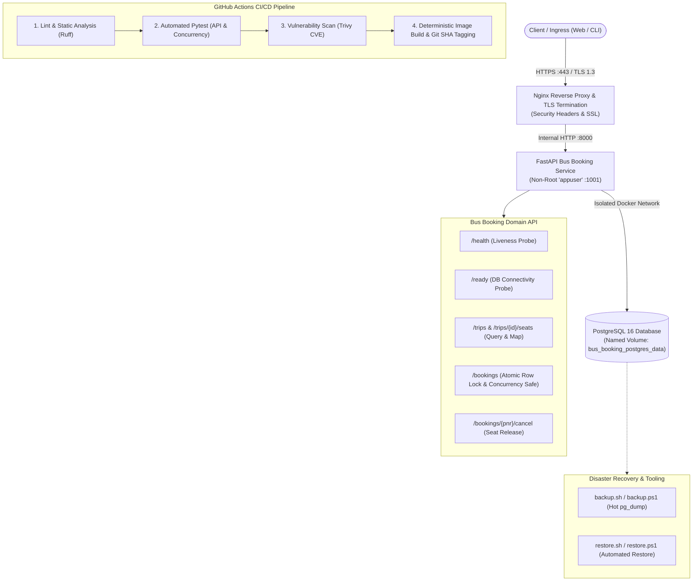

# Cloud Deployment & CI/CD — Bus Booking Platform

> **Assessment Track**: DevOps & Cloud Engineering — Advanced Individual Project Assessment  
> **Allocated Service**: Trip and Seat Reservation Domain Service  
> **Evaluation Focus**: Containerization, CI/CD, Reliability, Security, Observability, and Concurrency Correctness.

---

## 1. Executive Summary & Architecture

This repository delivers a production-grade, highly reliable, and observable microservice for bus trip schedule querying and concurrent seat reservations. Designed according to cloud-native best practices, it eliminates duplicate seat bookings under heavy concurrent load, enforces least-privilege container security, and provides complete operational runbooks for backup, disaster recovery, and release rollbacks.



---

## 2. Technology Stack & Key Decisions

| Layer | Component | Engineering Rationale |
| :--- | :--- | :--- |
| **Domain Service** | Python 3.12, FastAPI, SQLAlchemy 2 | High-performance asynchronous runtime with automatic Swagger UI documentation (`/docs`) and Pydantic v2 data validation. |
| **Relational Database** | PostgreSQL 16 (Alpine) | Full ACID compliance with row-level pessimistic locking (`with_for_update()`) and composite unique constraints to mathematically prevent race conditions. |
| **Reverse Proxy & Edge** | Nginx 1.27 (Alpine) | TLS termination (HTTPS :443), HTTP-to-HTTPS redirect, and strict security headers (`HSTS`, `X-Frame-Options`, `X-Content-Type-Options`). |
| **Containerization** | Docker & Docker Compose | Multi-stage build dropping build tools, non-root execution (`appuser:1001`), persistent named volumes, and deterministic health checks. |
| **CI/CD Pipeline** | GitHub Actions | 4-stage automated pipeline: Ruff linting, Pytest test suite, Trivy container security scanning, and SHA-tagged image builds. |
| **Observability** | Structured JSON Logging | Structured stdout log stream (`timestamp`, `request_id`, `method`, `path`, `status_code`, `duration_ms`) + separate `/health` and `/ready` probes. |

---

## 3. Quickstart & Deployment Instructions

### 3.1 Prerequisites
* Docker Engine 24+ and Docker Compose v2+
* Git
* (Optional) Python 3.12+ for local script execution

### 3.2 1-Command Clean Deployment
```bash
# 1. Clone repository
git clone <YOUR_REPO_URL>
cd "mohit company"

# 2. Boot up all container services
docker compose up -d --build
```

### 3.3 Verify Container Health
```bash
docker compose ps
```
All three services (`bus_booking_nginx`, `bus_booking_app`, `bus_booking_db`) will report status **`(healthy)`**.

### 3.4 Access the Service
* **API Documentation (Swagger UI)**: [http://localhost:8000/docs](http://localhost:8000/docs)
* **Secure HTTPS Ingress**: [https://localhost/docs](https://localhost/docs)
* **Liveness Probe**: `curl http://localhost:8000/health`
* **Readiness Probe**: `curl http://localhost:8000/ready`

---

## 4. API Endpoints Specification

| Method | Endpoint | Description |
| :--- | :--- | :--- |
| `GET` | `/health` | Liveness check (returns process health and version). |
| `GET` | `/ready` | Readiness check (executes live query against PostgreSQL; returns 503 if DB is down). |
| `GET` | `/trips` | Query trips with optional filters (`travel_date`, `origin`, `destination`). |
| `GET` | `/trips/{id}/seats` | Retrieve seat availability map and seat states (`AVAILABLE`, `BOOKED`). |
| `POST` | `/bookings` | Reserve a seat with atomic concurrency locking. Returns generated PNR. |
| `GET` | `/bookings/{pnr}` | Lookup reservation details by PNR code. |
| `POST` | `/bookings/{pnr}/cancel` | Cancel booking and release seat back to `AVAILABLE`. |

---

## 5. Concurrency Isolation & Acceptance Proof

### Acceptance Rule: Prevent Duplicate Confirmed Reservations
When two or more users attempt to book the exact same seat on the same trip simultaneously, standard non-isolated code creates duplicate PNRs and double-bookings.

**Our Solution**:
1. **Pessimistic Row Lock (`SELECT ... FOR UPDATE`)**: The database row for the specific `Seat` is locked during the transaction. Subsequent concurrent transactions are forced to wait.
2. **Atomic Status Transition**: The seat status is verified. If already `BOOKED`, the transaction immediately aborts with `HTTP 409 Conflict`.
3. **Database Unique Constraints**: `uq_trip_seat_number` guarantees schema-level integrity.

### Automated Concurrency Stress Test
Run the automated multi-threaded stress test:
```bash
python scripts/test_concurrency.py http://localhost:8000
```
**Observed Result**:
* 4 parallel threads fire at the identical millisecond for Seat `3A`.
* **Thread 1**: `HTTP 201 Created` — Received PNR `PNR-XXXXXX`.
* **Threads 2, 3, 4**: `HTTP 409 Conflict` — Rejected with *"Seat 3A is already booked or unavailable"*.
* Database verifies **zero duplicate PNRs**.

---

## 6. Disaster Recovery, Backup & Restore

### Backup Execution
* **Linux / macOS**: `bash scripts/backup.sh`
* **Windows (PowerShell)**: `.\scripts\backup.ps1`
Generates clean timestamped database snapshots in `./backups/`.

### Restore Execution Drill
* **Linux / macOS**: `bash scripts/restore.sh`
* **Windows (PowerShell)**: `.\scripts\restore.ps1`
Safely restores database schema, seeded trips, and confirmed bookings.

---

## 7. Failure Detection & Self-Healing Drill

1. **Break DB**: `docker compose stop db`
2. **Inspect Readiness**: `curl -i http://localhost:8000/ready` $\rightarrow$ **`HTTP 503 Service Unavailable`**.
3. **Inspect Logs**: `docker compose logs --tail=20 app` shows database connection drop logged with severity `ERROR`.
4. **Self-Heal**: `docker compose start db` $\rightarrow$ After health check passes, `curl -i http://localhost:8000/ready` returns **`HTTP 200 OK`**.

---

## 8. Rollback Procedure

To roll back a faulty deployment without data loss:
1. Re-tag or set image version in `.env`: `IMAGE_TAG=sha-<PREVIOUS_COMMIT>`
2. Execute rolling update: `docker compose up -d app`
3. Verify liveness/readiness: `curl -f http://localhost:8000/health && curl -f http://localhost:8000/ready`

---

## 9. Rubric Evidence Mapping

| Rubric Criterion | Marks | Implementation Evidence |
| :--- | :--- | :--- |
| **Containerization & Reproducibility** | **20** | Multi-stage `Dockerfile`, non-root user `appuser:1001`, `docker-compose.yml`, persistent volume `bus_booking_postgres_data`. |
| **CI/CD Automation** | **20** | `.github/workflows/ci.yml` (Ruff lint, Pytest unit tests, Trivy CVE scan, Docker build with SHA tag). |
| **Deployment, Networking & Security** | **15** | Nginx reverse proxy, TLS/HTTPS (:443), security headers (HSTS), network isolation, no hardcoded secrets, `.env.example`. |
| **Observability & Troubleshooting** | **15** | Structured JSON logs, `/health` and `/ready` probes, failure injection & recovery drill. |
| **Backup, Restore & Rollback** | **15** | `scripts/backup.*`, `scripts/restore.*`, and documented rollback procedure in `RUNBOOK.md`. |
| **Reliability & Documentation** | **10** | Comprehensive `README.md`, `RUNBOOK.md`, and 3-minute video walkthrough guide. |
| **Domain API Correctness** | **5** | Concurrency-safe `/bookings`, PNR generation, cancellation, seed data, and passing test suite. |
